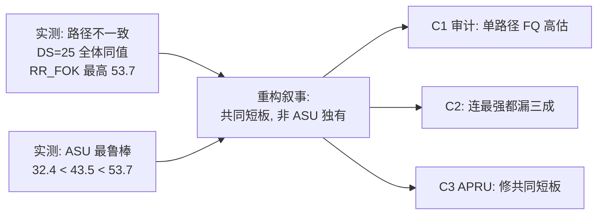

# Proposal v4 · Sanity Check 通过 + 诚实叙事重构

> 来源：[Proposal v4 · Sanity Check 结果 + 诚实叙事重构 · AI Algo Lab](./Proposal%20v4%20·%20Sanity%20Check%20结果%20+%20诚实叙事重构%20·%20AI%20Algo%20Lab.html)
> 版本日期：2026-11-19

按预定判据，**H1、H2 均达阈**，「审计 + FocusOnKey + APRU」story 可开写。本版把实测数据填入，并按数据如实调整三处叙事：从“ASU 特有脆弱”改为“全体方法的共同短板”——结论更普适、更抗 rebuttal。数据来自 TOFU forget05 / retain95，Llama-2-7B-Chat，seed 1001。

- ✅ H1 = 31.2 > 10
- ✅ H2 = 32.4% > 20%
- 📊 实测数据已填入
- 🔄 叙事已重构
- ⚠️ 主表待补 3 项

---

## 1. Sanity Check 判定（通过）

### H1 · 路径不一致

$$
\max(FQ_{SH}, FQ_{HS}) - \min(FQ_{DS}, FQ_{MT}) = 56.2 - 25.0 = \mathbf{31.2} > 10
$$

**✅ 成立。** 差距来自单跳对 DS；MT = 71.4 高于 SH = 56.2，故“DS 和 MT 都更漏”只对 DS 成立。

### H2 · 恢复攻击有效

$$
RR_{\text{FocusOnKey}}(\mathrm{ASU}) = 32.4\% > 20\%
$$

**✅ 成立。** 与 GA = 43.5%、NPO = 53.7% 同量级，ASU 三者中最低（最鲁棒）。

> 设置：TOFU forget05 / retain95，Llama-2-7B-Chat，seed 1001；ASU τ = 2.3、α(λ) = 0.1；θ_p 单跳准确率 0.970；FQ 为百分点，RR 为百分数。

---

## 2. 实测数据（v4 填入）

| Method | FQ_SH | FQ_HS | FQ_MP | FQ_LL | FQ_CC | FQ_DS | FQ_MT | RR_FOK | RR_Probab |
| --- | ---: | ---: | ---: | ---: | ---: | ---: | ---: | ---: | ---: |
| **ASU** | **56.2** | 50.0 | NA | 100.0 | 40.0 | 25.0 | **71.4** | **32.4** | 42.6 |
| GA | 55.7 | 0.0 | NA | 50.0 | 20.0 | 25.0 | 57.1 | 43.5 | 56.5 |
| NPO | 40.7 | 0.0 | NA | 50.0 | 0.0 | 25.0 | 57.1 | 53.7 | 75.5 |

**读表要点：**
1. DS 三方法全为 25.0 → 共同短板，非 ASU 特有；
2. ASU 的 MT = 71.4 全场最高 → ASU 在 MT 上忘得最干净，不是最漏；
3. ASU 的 RR 两项均最低 → 三者中最抗恢复；
4. MP = NA（θ_p = 0/10，分母失效），LL = 100 疑为分母过小虚高。

---

## 3. 叙事重构：从数据出发的三处修正（核心）

判据过了，但机制层面的先验预测被数据反证。以下三处必须按实测讲，否则 reviewer 会用我们自己的表反驳。

### C1 · 审计

- **旧**：「ASU 有特定的路径脆弱性」
- **新**：路径不一致是**全体方法的共同现象**：DS 三者同为 25，结构间跨度达 75 点（LL = 100 vs DS = 25）。单路径 FQ 系统性高估遗忘。

### C2 · FocusOnKey

- **旧**：「FocusOnKey 对撞 ASU，ASU 最脆弱」
- **新**：**连最鲁棒的 ASU 都漏 32.4%**——一次简单的关键 token 重复就恢复三分之一知识。先验预测 ASU 最脆弱、实测相反，如实报告。

### C3 · APRU

- **旧**：「修复 ASU 的弱点」
- **新**：修复**全体方法的共同短板**（DS = 25）：跨路径一致性 + DS 加权。APRU 不需要 ASU 坏才有意义。

### 一句话重构后的 story

不是抓 ASU 一个坏人，而是抓出一条**所有方法都踩的坑**——单路径遗忘质量严重高估真实隐私保护，结构变换与简单恢复攻击即可套回知识。ASU 是最有代表性的样本（因它明确声称“跨格式泛化”），APRU 是对这条坑的系统性修补。

> **诚实声明（写进论文）**：我们曾预测 attention-smoothing 会因降低 key-token 注意力而对 FocusOnKey 特别脆弱；实测 ASU 的恢复率三者最低（32.4% < GA 43.5% < NPO 53.7%），预测被反证。这一阴性结果反而强化了“行为遗忘 ≠ 隐私”的普适性——最鲁棒的方法仍漏三成。

---

## 4. 主表需补三项（必办）

| 项 | 问题 | 处理 |
| --- | --- | --- |
| ① 基线对齐 | NPO FQ_SH = 40.7 vs ASU 56.2，差 15.5 点；β 扫 0.05 / 0.2 仍未拉回 | 补齐对齐后再下“ASU 优于 NPO”的对比结论；当前只写“在可比 forget level 下” |
| ② 粒度与分母 | MP = NA（θ_p = 0/10），DS = 25.0 全员同值（疑 1/4），LL = 100 虚高 | 主表换 forget10 / 完整样本 / 连续 FQ，否则该格数字会被质疑 |
| ③ 稳定性 | 单 seed = 1001、forget05 | 至少 3 seed 报均值 ± 方差；seed 1001 保留为 sanity seed |

> 这三项是“能否当主表”的门槛，不是“能否开写”的门槛——story 可按重构版先写，数字补齐后再最终填表。

---

## 5. APRU（动机已修订）

**Access-Path-Robust Unlearning**

核心洞察不变：teacher θ_τ 对任意输入都天然平滑，ASU 却只用原始 forget prompt 蒸馏；APRU 在整个等价路径族上一致对齐。**v4 修订：解的是全体方法共同短板 DS = 25，而非 ASU 独有弱点。**

### ① 路径增强

$$
\tilde{\mathcal{D}}_F = \{ t(x_f) \mid x_f \in \mathcal{D}_F,\ t \in \mathcal{T} \}
$$

$\mathcal{T}$ 含 6 逻辑结构 + 跨语言 + 转述 + 补全式；重点覆盖最抗遗忘的 DS。

### ② 结构加权一致性蒸馏

$$
\mathcal{L}_{APRU} = \mathbb{E}_{x_f}\,\mathbb{E}_{t \sim \mathcal{T}}\Big[\, w(t)\,\mathrm{KL}\big( p_\tau(\cdot \mid t(x_f)) \,\Vert\, p_\theta(\cdot \mid t(x_f)) \big) \Big]
$$

$w(t)$ 对高泄露结构上加权——直接针对 DS = 25 的共同短板。

### ③ 表示级擦除

$$
\mathcal{L}_{rep} = \mathbb{E}\sum_{\ell \in \mathcal{L}} \big\| H^{\ell}(t(x_f); \theta) - H^{\ell}(t(x_f); \theta_\tau) \big\|_2^2
$$

输出 + 表示双擦；增大权重差以抗 Quantization 抹平。

### ④ 总目标 + 对抗挖掘

$$
\min_{\theta}\ \lambda_1 \mathcal{L}_{APRU} + \lambda_2 \mathcal{L}_{rep} + \mathcal{L}_{retain},
\qquad
\min_{\theta}\max_{\phi}\ \mathbb{E}_{t \sim t_\phi}\ \mathrm{leak}\big(t(x_f)\big)
$$

---

## 6. 实验矩阵（v4）

| 维度 | 取值 | 状态 |
| --- | --- | --- |
| **已测（sanity）** | TOFU forget05/retain95, Llama-2-7B-Chat, seed 1001, ASU/GA/NPO × 6 结构 + FOK/Probab | 已完成，见第 2 节 |
| 模型 | + Llama-3.1-8B, Qwen3-14B/32B | 待补 |
| 数据集 | + TOFU forget10, MUSE, WMDP + MQuAKE/Books（LeakRU） | 待补（含主表粒度） |
| 方法 | ASU 主对象 + GA/NPO（需对齐）+ RMU, TV, PALU, AS, SimNPO, SalUn | 部分待补 |
| 攻击/路径 | 6 结构 + SH/MH + FOK/Probab/Quantization + 跨语言/转述 | Quantization / 跨语言待补 |
| 稳定性 | ≥ 3 seed 均值 ± 方差 | 待补 |

叙事流向图：

---

## 7. Proposal v4 骨架（按数据重写）

### Title 备选

1. One Prompt Is Not Enough: Path Inconsistency and Recovery Leakage in LLM Unlearning
2. Beyond Single-Path Forget Quality: Auditing and Repairing Leak-Resistant Unlearning
3. Even the Most Robust Leaks: Access-Path-Robust Unlearning for LLMs

### 定位

**审计驱动方法**：C1 统一审计协议（含 LeakRU）+ C2 实测发现（路径不一致 + 连最强都漏）+ C3 APRU 修复共同短板 + C4 逻辑结构不变遗忘理论。

### Abstract 骨架（v4 修订）

【背景】LLM 遗忘常以单路径 forget quality（FQ）衡量；ASU 声称跨格式泛化遗忘。【问题】我们审计发现 FQ 严重依赖访问路径：DS 结构下所有方法 FQ 仅 25 点，而 LL 达 100；三种方法在 FocusOnKey 下仍可恢复 32–54% 知识——连最鲁棒的 ASU 也漏 32.4%。【方法】提出统一审计协议（6 逻辑结构 + 恢复攻击 + 跨语言/转述）与修复算法 APRU（路径族一致性蒸馏 + 结构加权 + 表示对齐）。【发现】路径不一致是全体方法共同短板；attention 平滑方法并非如预期对 token 重复特别脆弱，反为最鲁棒，但绝对泄露仍不可接受。【结论】可恢复性应取代单路径 FQ 成为遗忘评估核心。

---

## 8. 风险与 Rebuttal（v4）

### 预案

- “ASU 明明最鲁棒，你的对撞不成立” → 已改为“连最强都漏”，如实报告先验被反证，不声称 ASU 特有脆弱
- “DS = 25 三方法同值，是不是样本太小” → 承认是 pilot，主表换 forget10 + 完整样本 + 连续 FQ
- “基线没对齐” → NPO 未对齐已标注；补齐前不下 ASU 优于 NPO 的结论
- “这不就是 LeakRU” → 增量是跨方法路径不一致的实证 + APRU + 理论

### 诚实边界

- 当前结果基于单 seed / forget05 → 定位为 sanity check，非主表
- 机制预测（ASU 对 FOK 最脆弱）被数据反证 → 论文须如实写
- APRU 设计与 ρ/Y 等数值仍待实测
- ASU / LeakRU 机制与指标来自各自全文核实

> **数据忠实性**：本页所有数值直接来自用户提供的 sanity check 结果表（TOFU forget05 / retain95, Llama-2-7B-Chat, seed 1001）。判定按预定规则执行，叙事按数据如实重构，未调参、未修饰阴性结果。

---

*AI Algo Lab · v4 · sanity check 结果版 · 2026-11-19*
